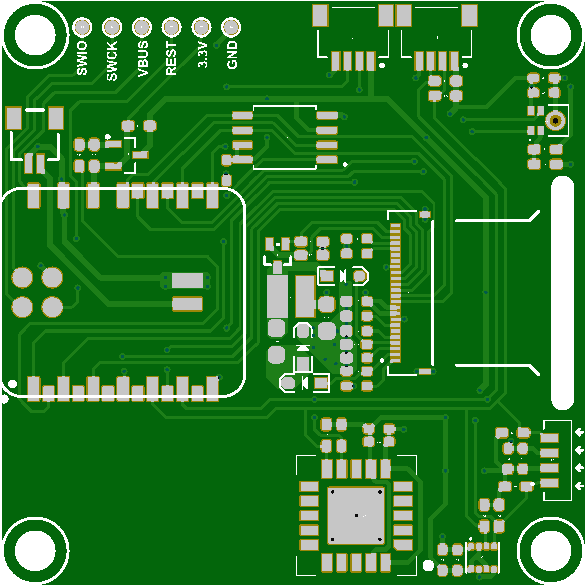
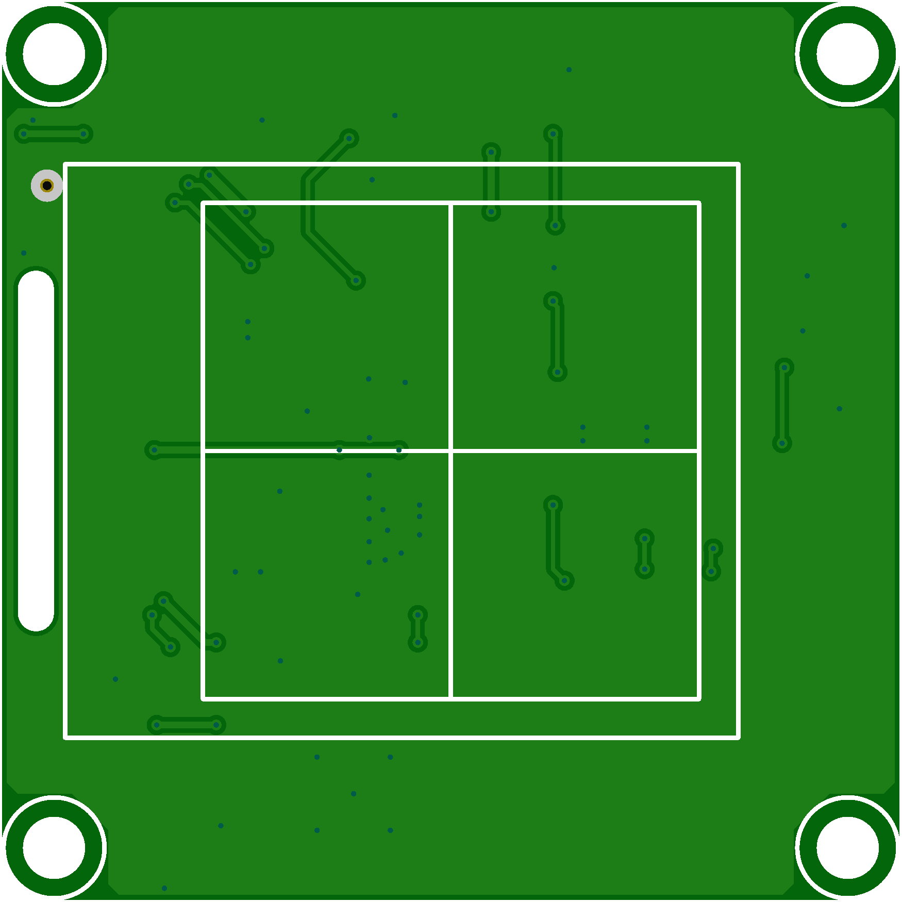

# Quiesco hardware

Everything you need to manufacture a Quiesco unit: the PCB **v1**
(`L-1K1W1007851A`) design and factory files, and the 3D-printable enclosure.

PCB v1 comes in two versions. They are the same board except for the battery
connector, J2. Each version has its own folder, and the two sets of files
must not be mixed.

| Version | Folder | J2, battery connector | Battery that plugs in | Design tool |
|---|---|---|---|---|
| **JST SH** | [`pcb-jst-sh/`](pcb-jst-sh/) | JST **SM02B-SRSS-TB**, SH 1.0 mm, 2-pin | any 453035-size LiPo with a JST SH 1.0 lead | Altium |
| **Minitek** | [`pcb-minitek/`](pcb-minitek/) | Amphenol **10144041-02011LF**, Minitek 0.8 mm, 2-pin | EEMB **LP402535-PCM-PTC-LD/-A22852**, IEC 62133-2 certified, used as supplied | KiCad |

In both versions J2 sits in the same place, pin 1 is VBAT and pin 2 is GND.

<table>
  <tr>
    <td align="center" width="50%"><br><sub><b>Top</b>: XIAO module, e-ink FPC, flash, SCD41, VEML7700, mic</sub></td>
    <td align="center" width="50%"><br><sub><b>Bottom</b></sub></td>
  </tr>
</table>

## Contents

- [The board at a glance](#the-board-at-a-glance)
- [Folder layout](#folder-layout)
- [Order the board](#order-the-board)
- [Parts not on the board](#parts-not-on-the-board)
- [Print the case](#print-the-case)
- [Assemble](#assemble)
- [Next: flash and test](#next-flash-and-test)

## The board at a glance

A two-layer PCB built around a **Seeed XIAO nRF52840 Plus** module, which
brings the MCU, Bluetooth radio, USB-C and LiPo charger. Every peripheral sits
on a **switched 3.3 V rail** that the firmware turns off between measurements.

| Ref | Part | Job |
|---|---|---|
| U3 | Seeed XIAO nRF52840 Plus | MCU, BLE, USB-C, LiPo charger |
| U6 | Sensirion SCD41-D-R1 | CO₂ (I²C `0x62`) |
| U2 | Bosch BME280 | temperature, humidity, pressure; pressure also compensates CO₂ (I²C `0x76`) |
| U5 | Vishay VEML7700 | ambient light (I²C `0x10`) |
| U4 | Knowles SPH0641LU4H-1 | PDM MEMS microphone |
| U1 | Winbond W25Q64JVSSIQ | 8 MB SPI NOR flash: config and sample log |
| J1 | 24-pin 0.5 mm FPC | GoodDisplay GDEW0154T8D e-ink panel |
| Q1 | AO3401 P-MOSFET | switched peripheral rail (`3V3ON`, active LOW) |
| Q2, L1, D1–D3 | SI1308EDL, 10 µH, MBR0530 | e-ink gate-voltage boost |
| J2 | 2-pin battery connector: JST SH 1.0 or Amphenol Minitek 0.8, depending on the [version](#quiesco-hardware) | battery |
| J3 / J4 | JST 4-pin | I²C and UART expansion |
| T1–T6 | test pads | SWDIO, SWCLK, VBUS, RESET, 3.3 V, GND |

The pin map, power sequencing, bus details and known quirks are documented
from the firmware's point of view in
[`firmware/HARDWARE.md`](../firmware/HARDWARE.md).

> [!IMPORTANT]
> The fitted module is the plain **Plus**, not the **Sense Plus**: v1 has no IMU,
> and the board's own external mic (U4) is the only microphone.

## Folder layout

```text
hardware/
├── pcb-jst-sh/                  PCB v1, J2 = JST SH 1.0 (SM02B-SRSS-TB)
│   ├── source/                  Altium project: .PrjPcb, .SchDoc, .PcbDoc
│   │   ├── schematic.pdf        schematic, printable
│   │   └── old/                 earlier schematic and BOM, for reference
│   ├── manufacturing/           what the factory needs
│   │   ├── gerbers/             Gerbers, drill files, IPC netlist
│   │   ├── bom.xlsx             bill of materials
│   │   ├── pick-and-place.csv   centroid file
│   │   └── process-spec.xlsx    fabrication settings
│   └── renders/                 top.png, bottom.png
├── pcb-minitek/                 PCB v1, J2 = Amphenol Minitek (10144041-02011LF)
│   ├── source/                  KiCad project: .kicad_pro, .kicad_sch, .kicad_pcb
│   └── manufacturing/
│       ├── gerbers/             Gerbers and drill files
│       ├── bom.xlsx             bill of materials
│       └── pick-and-place.csv   centroid file
└── case/                        enclosure, shared by both versions
    ├── v1/                      case-v1.stl (ready to slice), case-v1.step (editable)
    ├── v2/                      case-v2.stl, case-v2.step (in test)
    ├── assembly.step            full assembly with the PCBA
    ├── assembly-instructions.docx
    └── exploded.mp4             exploded-view animation
```

## Order the board

First pick the [version](#quiesco-hardware), then take every file from that
version's `manufacturing/` folder only.

1. **Zip the Gerbers.** Compress `manufacturing/gerbers/` into one archive and
   upload it as the PCB.
2. **Add assembly.** Upload `manufacturing/bom.xlsx` as the BOM and
   `manufacturing/pick-and-place.csv` as the centroid file.
3. **Share the process spec.** `pcb-jst-sh/manufacturing/process-spec.xlsx`
   holds the fabrication settings used for the first boards, which PCBWay
   produced from the Altium outputs.
4. **Mind the not-fitted parts.** R1, R2, R3, R5, R6, R7, R8 and R9 are marked
   `NC` in the BOM and must stay empty: R1 would flip the microphone's
   channel, R7 is an unused rail bleeder, and the rest are per-sensor I²C
   pull-ups that the shared R14/R15 pair replaces.

## Parts not on the board

These ship loose and plug in during assembly (they are listed at the bottom of
the BOM):

| Part | Spec | Notes |
|---|---|---|
| E-ink panel | GoodDisplay **GDEW0154T8D**, 1.54″, 152 × 152, 24-pin 0.5 mm FPC | plugs into J1 |
| Battery, JST SH version | **3.7 V ~400 mAh** LiPo, **453035** size (4.5 × 30 × 35 mm), with a **JST SH 1.0 2-pin** lead, 10 cm, single-ended | plugs into J2. **Check polarity before plugging in** |
| Battery, Minitek version | EEMB **LP402535-PCM-PTC-LD/-A22852**: 3.7 V, 320 mAh typical, 37.0 × 25.5 × 4.3 mm max, with PCM and PTC fitted, 33 mm lead, Amphenol 10145492-02LF plug | plugs into J2 as supplied. Don't cut, crimp or extend the lead: any change voids the cell's IEC 62133-2 certificate |
| Screws | **4 × M3×10** hex socket head | close the case |

## Print the case

The enclosure is a two-part shell, about **53 × 53 × 15 mm**.

### Material

**MJF PA12 nylon, dyed black**, is the production material. Any MJF
service can print it; order both parts in PA12 with black dyeing.

The same files were printed in three processes to choose it
([build log with photos](https://hackaday.io/project/207079-quiesco/log/252495-choosing-a-case-material-abs-resin-or-mjf-nylon)):

| Process | Finish | Strength | Per case, 50 units | Verdict |
|---|---|---|---|---|
| FDM ABS | layer pattern on every face and in the screw counterbores | good | cheapest | prototypes only; some services can't print the 3.4 mm bezel |
| Black resin | smoothest, but shows every speck, scratch and fingerprint; standard black looks greyish and streaky | more brittle where the screws bite | ~$4 | no; Imagine Black is deeper but softens at 46 °C |
| **MJF PA12 nylon** | even matte black, fine grain that hides marks, clean vents | tough, screws thread in well | ~$5 | **chosen** |

Prices are JLC3DP online quotes from October 2026, before import VAT.

### Files

Both PCB versions fit the same case. The case pocket is about 38 × 30.5 mm,
with 8.5 mm above the board, so either battery fits.

- **Print** `case/v1/case-v1.stl` as-is.
- **Modify** `case/v1/case-v1.step` in your CAD tool, and use
  `case/assembly.step` to check clearances against the populated board.

**v2, in test.** `case/v2/case-v2.stl` and `case/v2/case-v2.step` rework the
vents and the light sensor opening. The display window and the board fit are
unchanged:

| Feature | v1 | v2 |
|---|---|---|
| Side vent | 6 slots, 1.5 mm wide, 1 mm fins | 5 slots, 1.8 mm wide, 1.6 mm fins, 45° pointed end (prints back-down without bridging) |
| Second vent | none | same 5 slots on the opposite wall, for cross-flow |
| Light sensor | 10.4 × 6.6 × 0.8 mm pocket for a clear insert | open 7.8 × 4.0 mm hole through the wall |
| Bezel outline | 50.3 mm, 0.1 mm clearance per side | 50.0 mm, 0.25 mm clearance per side |

Both versions have walls down to about 0.5 mm at the bezel corners and one
inner corner of the shell, below most print services' minimum. In MJF nylon
they print and hold up, but the 0.5 mm skin over each bezel screw hole
shows as a small dot on the front. A revision that leaves a 1.0 mm skin
(pilot holes 2.4 mm deep instead of 2.9 mm) and thickens the shell corner
is in progress. Use v1 until v2 has been tested.

If you change the window, re-measure how much of the panel it hides: the
screens leave a 7 px top inset for the v1 case (see
[`firmware/UI.md`](../firmware/UI.md#1-canvas)).

## Assemble

1. **Connect the display.** Open the J1 FPC latch, slide in the e-ink ribbon
   and close the latch. A badly seated ribbon shows up as missing rows in the
   factory test.
2. **Fit the battery.** Plug it into J2 and fix it in the lid, between
   the two ribs above the XIAO module, with double-sided tape.
3. **Seat the board in the lower shell.** Align the USB-C port with its
   opening first, then lower the board in.
4. **Close the case.** Make sure the microphone opening in the upper cover
   lines up with the hole on the PCBA, then drive in the four M3×10 screws.

## Next: flash and test

With the unit assembled, head to [`firmware/`](../firmware/README.md#test-a-new-unit)
to run the factory test sketch and flash the release firmware.

---

<sub>← Back to the [Quiesco overview](../README.md)</sub>
